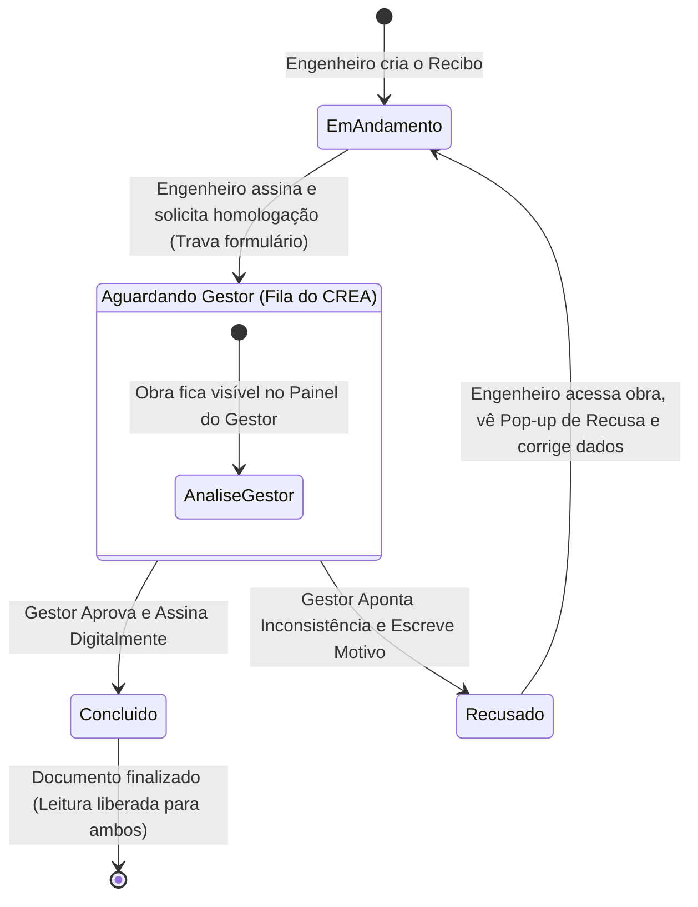

# Especificação Técnica: Sistema de Assinatura Eletrônica com Validade Jurídica (ConectObra)

Este documento descreve a arquitetura, o fluxo operacional, a segregação de papéis e o embasamento legal para a implementação do sistema nativo de **Assinatura Eletrônica Avançada** no ConectObra.

---

## 1. Marco Legal e Validade Jurídica

O sistema está fundamentado nas normas vigentes do direito brasileiro:

- **Medida Provisória nº 2.200-2/2001 (Art. 10, § 2º)**: Reconhece a validade jurídica de documentos eletrônicos produzidos mediante meios de comprovação de autoria e integridade aceitos pelas partes.
- **Lei Federal nº 14.063/2020**: Classifica o formato como **Assinatura Eletrônica Avançada**, cumprindo os requisitos:
  1. Associação unívoca ao signatário;
  2. Uso de dados sob o controle exclusivo do titular (sessão institucional do gestor, credenciais CREA do engenheiro e posse do canal de WhatsApp do proprietário);
  3. Detecção de qualquer modificação posterior via **Hash Criptográfico SHA-256**.
- **Normas CONFEA/CREA (Resolução nº 1.025/2009 e 1.094/2017)**: Embasamento para autoria, responsabilidade técnica, diário de obra e homologação institucional de livros de ordem.

---

## 2. Matriz de Signatários por Tipo de Documento

A regra de negócio do ConectObra divide os documentos em duas esteiras de assinatura:

| Documento | 1º Signatário | 2º Signatário | Canal de Assinatura |
| :--- | :--- | :--- | :--- |
| **Recibo de Responsabilidade Técnica** | **Engenheiro** (Responsável Técnico) | **Gestor do CREA** (Funcionário Nível 2) | Interno no Sistema (Painel Institucional) |
| **Relato de Visita Técnica** | **Engenheiro** (Responsável Técnico) | **Proprietário da Obra** | Externo via Link Seguro no WhatsApp |
| **Termo de Conclusão de Serviços** | **Engenheiro** (Responsável Técnico) | **Proprietário da Obra** | Externo via Link Seguro no WhatsApp |

> [!IMPORTANT]
> **Alteração Fundamental no Recibo**: O proprietário **não assina o Recibo**. O Recibo é o documento de abertura e responsabilidade técnica homologado entre o **Engenheiro** e o **Gestor do CREA**.

---

## 3. Fluxo Operacional do Recibo (Engenheiro ⟷ Gestor do CREA)



---

### 3.1. Etapa 1: Preenchimento e Travamento pelo Engenheiro
1. Enquanto o Recibo estiver com status `em_andamento`, o engenheiro pode preencher e alterar livremente os dados.
2. A obra **NÃO aparece** na listagem do painel do gestor.
3. Quando o engenheiro julgar o documento completo, clica no botão:
   **`[ Assinar e Solicitar Homologação do CREA ]`**.
4. Ao clicar:
   - O sistema gera o hash SHA-256 dos dados e grava a assinatura do engenheiro (IP, data/hora oficial e registro CREA).
   - O status do Recibo muda para **`aguardando_gestor`**.
   - **Travamento estrito**: O formulário do Recibo é **completamente bloqueado para edição**. Nenhuma alteração é permitida enquanto estiver sob análise do CREA.

---

### 3.2. Etapa 2: Análise e Decisão no Painel do Gestor (`/painel/`)
1. No painel do Gestor do CREA, a obra passa a constar na seção:
   **"Recibos Pendentes de Homologação / Assinatura do CREA"**.
2. O gestor clica para abrir o documento oficial timbrado, conferindo:
   - Dados do contratante/proprietário;
   - Quadro de áreas e tipo de atividade técnica;
   - Endereço e dados da obra;
   - Assinatura eletrônica já aposta pelo Engenheiro.
3. O gestor possui duas opções de ação:

#### Opção A: Homologar e Assinar
- O gestor clica em **`[ Homologar e Assinar Recibo ]`**.
- Abre-se um modal de segurança onde o gestor deve **digitar sua senha de acesso ao sistema** para confirmar a assinatura (2º fator de autenticação para não-repúdio jurídico).
- O sistema valida a senha, registra a assinatura do Gestor (IP, data/hora oficial e matrícula de funcionário do CREA).
- O Recibo passa para o status **`concluido`**.
- O documento final congelado fica disponível para visualização e download em PDF tanto para o Gestor quanto para o Engenheiro.
- A caderneta é liberada para a criação de novos Relatos de Visita Técnica.
- **Disparo de E-mail Automático**: O sistema envia um e-mail ao engenheiro informando que o Recibo da obra foi **homologado com sucesso pelo CREA**, com link direto para visualização.

#### Opção B: Recusar com Justificativa
- Se houver inconsistência (ex: áreas divergentes, atividade técnica incorreta), o gestor clica em **`[ Recusar Assinatura ]`**.
- Abre-se um campo obrigatório: **"Motivo da inconsistência técnica"**.
- Ao confirmar a recusa:
  - O sistema salva o texto da justificativa no campo `motivo_recusa`.
  - O status do Recibo muda para **`recusado`**.
  - A assinatura anterior do engenheiro é invalidada (pois o documento precisará ser retificado).
  - O Recibo sai da fila de pendências do gestor.
  - **Disparo de E-mail Automático Imediato**: O sistema dispara um e-mail para o engenheiro com o assunto `[CREA Adamantina] Pendência Apontada no Recibo - Obra {nome_obra}`, contendo na íntegra a justificativa do gestor e orientações para correção.

---

### 3.3. Etapa 3: Notificação do Engenheiro via Pop-up e Retificação
1. Além do e-mail recebido, quando o Engenheiro acessar a obra no sistema (na página da Caderneta ou no próprio Recibo), o sistema detecta `status == 'recusado'`.
2. O sistema dispara automaticamente um **Pop-up Modal de Alerta**:

```
┌────────────────────────────────────────────────────────────────────────┐
│ ⚠️ PENDÊNCIA TÉCNICA APONTADA PELO CREA                               │
├────────────────────────────────────────────────────────────────────────┤
│ O gestor do CREA analisou o Recibo de Responsabilidade Técnica da     │
│ obra "Residência Jardim das Flores" e recusou a homologação.           │
│                                                                        │
│ Motivo da Inconsistência:                                              │
│ "A área a regularizar informada (120m²) está divergente da planta      │
│ aprovada pelo município anexa ao processo. Favor retificar."           │
│                                                                        │
│ O formulário foi liberado para edição para que você faça as correções. │
├────────────────────────────────────────────────────────────────────────┤
│ [ Entendido, Corrigir Informações ]                                    │
└────────────────────────────────────────────────────────────────────────┘
```

3. Ao fechar o modal:
   - O status volta para **`em_andamento`**.
   - Os campos do formulário são **desbloqueados para edição**.
   - O engenheiro realiza os ajustes necessários.
   - Quando estiver corrigido, o engenheiro assina novamente e solicita nova homologação, reiniciando o ciclo de análise.

---

## 4. Fluxo dos Relatos e Termo de Conclusão (Engenheiro ⟷ Proprietário)

Para os documentos que exigem a ciência do cliente final:

1. **Relato de Visita Técnica** e **Termo de Conclusão**:
   - O engenheiro preenche no canteiro de obras e clica em **"Enviar para o Proprietário via WhatsApp"**.
   - Abre o WhatsApp (`wa.me`) com o link seguro único (`/assinar/<token_uuid>/`).
   - O proprietário abre no celular, confere o relatório com as fotos da visita, digita o **CPF**, visualiza seu nome renderizado em **fonte cursiva elegante** e clica em **Confirmar Assinatura**.
   - O sistema grava a trilha de auditoria invisível (IP, data/hora e User-Agent) e conclui o documento.

---

## 5. Trilha de Auditoria e Folha de Autenticidade

Tanto para a assinatura do Gestor do CREA quanto para a do Proprietário, o documento PDF incorpora a chancela jurídica:

```
┌────────────────────────────────────────────────────────────────────────────┐
│ CONECTOBRA • CERTIFICADO DE ASSINATURA ELETRÔNICA AVANÇADA                 │
├────────────────────────────────────────────────────────────────────────────┤
│ Documento: Recibo de Responsabilidade Técnica • Obra: Jardim das Flores    │
│ Hash SHA-256 do Documento Original: e3b0c44298fc1c149afbf4c8996fb92427a... │
├────────────────────────────────────────────────────────────────────────────┤
│ RESPONSÁVEL TÉCNICO                                                        │
│ Assinado por: ENG. JOÃO ENGENHEIRO (CREA: 123456/SP)                       │
│ Data e Hora: 20/10/2026 às 17:30:15 (Horário de Brasília)                  │
│ Autenticação: Sessão Autenticada ConectObra • IP: 177.18.23.45             │
├────────────────────────────────────────────────────────────────────────────┤
│ HOMOLOGAÇÃO INSTITUCIONAL CREA ADAMANTINA                                  │
│ Assinado por: CARLOS GESTOR (Matrícula CREA: 000002/SP)                    │
│ Data e Hora: 20/10/2026 às 17:45:00 (Horário de Brasília)                  │
│ Parecer: Homologado e de acordo com as normas vigentes                     │
│ Autenticação: Sessão Institucional Nível 2 • IP: 187.10.12.89              │
├────────────────────────────────────────────────────────────────────────────┤
│ [ QR CODE ]  Verifique a autenticidade apontando a câmera do celular       │
│              ou acesse: https://conectobra.com.br/validar/c8a2b1f0/        │
└────────────────────────────────────────────────────────────────────────────┘
```

---

## 6. Arquitetura Técnica no Django

### 6.1. Alterações no Modelo `Recibo` (`app/models.py`)

```python
# Novos choices de status do documento:
STATUS_DOCUMENTO = [
    ('em_andamento',    'Em andamento'),
    ('aguardando_gestor','Aguardando assinatura do CREA'),
    ('recusado',        'Recusado pelo CREA'),
    ('concluido',       'Homologado e Concluído'),
    ('cancelado',       'Cancelado'),
]

# Novos campos adicionados ao Recibo:
class Recibo(models.Model):
    # ... campos existentes (caderneta, usuario, proprietario, areas, etc.) ...
    
    status              = models.CharField('Status', max_length=20, choices=STATUS_DOCUMENTO, default='em_andamento')
    motivo_recusa       = models.TextField('Motivo da recusa do gestor', blank=True)
    recusa_visualizada  = models.BooleanField('Engenheiro visualizou a recusa', default=False)
    
    # Assinatura do Engenheiro
    assinado_eng_em     = models.DateTimeField('Assinado pelo engenheiro em', null=True, blank=True)
    ip_eng              = models.GenericIPAddressField(null=True, blank=True)
    
    # Assinatura do Gestor do CREA
    assinado_gestor_em  = models.DateTimeField('Homologado pelo gestor em', null=True, blank=True)
    gestor_signatario   = models.ForeignKey(User, on_delete=models.SET_NULL, null=True, blank=True, related_name='recibos_homologados')
    ip_gestor           = models.GenericIPAddressField(null=True, blank=True)
```

### 6.2. Regra de Travamento na View (`app/views.py`)

```python
# Na view detalhe_recibo:
if recibo.status in ('aguardando_gestor', 'concluido'):
    # Bloqueia qualquer tentativa de alteração via POST
    if request.method == 'POST':
        messages.error(request, 'Este documento está sob análise do CREA ou já foi homologado e não pode ser editado.')
        return redirect('detalhe_recibo', pk=recibo.pk)
```

### 6.3. Fila de Homologação no Painel do Gestor (`/painel/`)

Na view `painel_admin`:
- Adicionar ao contexto:
  ```python
  recibos_pendentes = Recibo.objects.filter(status='aguardando_gestor').select_related('caderneta', 'usuario', 'proprietario')
  ```
- No template `painel_admin.html`, adicionar a aba ou tabela com as obras aguardando assinatura, com botões para **"Revisar e Assinar"** ou **"Recusar"**.

---

## 7. Fases do Plano de Implementação Atualizado

| Fase | Descrição | Entregáveis |
| :--- | :--- | :--- |
| **Fase 1** | **Modelos e Migrações** | - Atualização dos status de `Recibo` (`aguardando_gestor`, `recusado`).<br>- Campos `motivo_recusa`, `recusa_visualizada` e dados de auditoria.<br>- Adição do campo `celular` em `Proprietario`. |
| **Fase 2** | **Fluxo do Recibo: Engenheiro ⟷ Gestor** | - Botão "Assinar e Solicitar ao CREA" na tela do Recibo.<br>- Travamento completo do formulário quando enviado.<br>- Tabela de pendências de homologação no `/painel/` do gestor.<br>- Modal de homologação com confirmação de senha do gestor.<br>- Modal de recusa com justificativa obrigatória.<br>- Disparo automático de e-mails de homologação/recusa para o engenheiro. |
| **Fase 3** | **Pop-up de Alerta para o Engenheiro** | - Pop-up modal avisando da recusa e exibindo a justificativa do gestor.<br>- Desbloqueio e retorno do formulário para `em_andamento`. |
| **Fase 4** | **Assinatura do Proprietário via WhatsApp (Relatos e Termo)** | - Rota e botão de envio via WhatsApp com link seguro (`wa.me`).<br>- Tela de assinatura mobile do proprietário (`/assinar/<token>/`) com CPF e fonte cursiva. |
| **Fase 5** | **Geração de PDF Timbrado e QR Code** | - Emissão do PDF oficial finalizado com certificado e QR Code de validação. |
