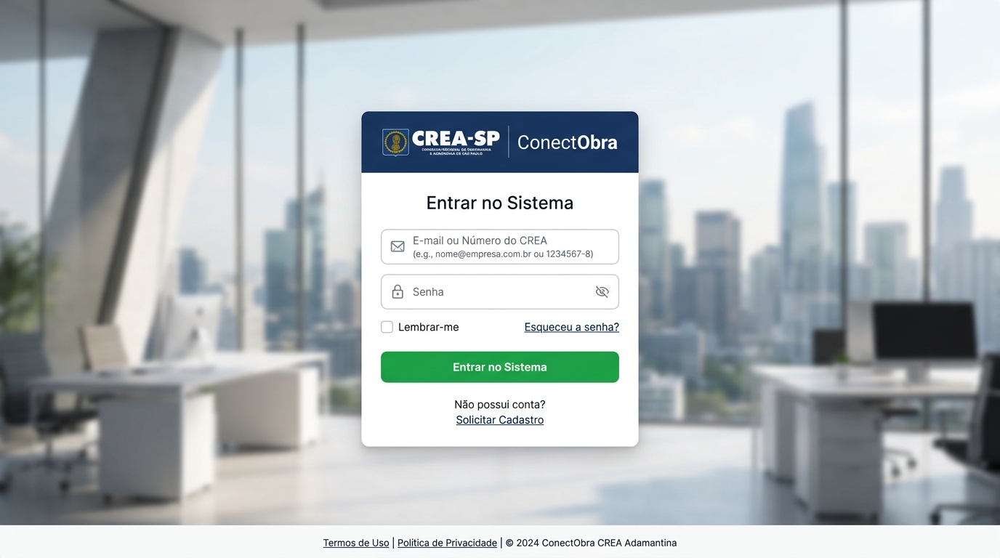
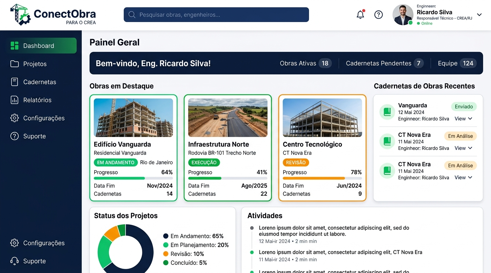
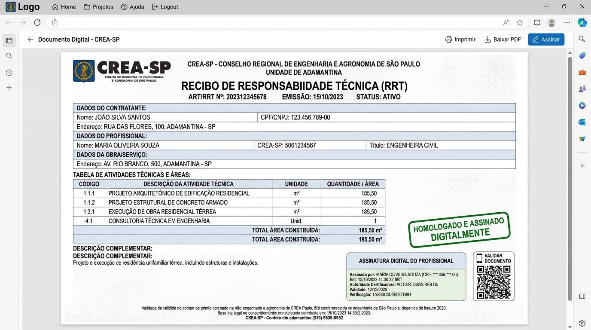
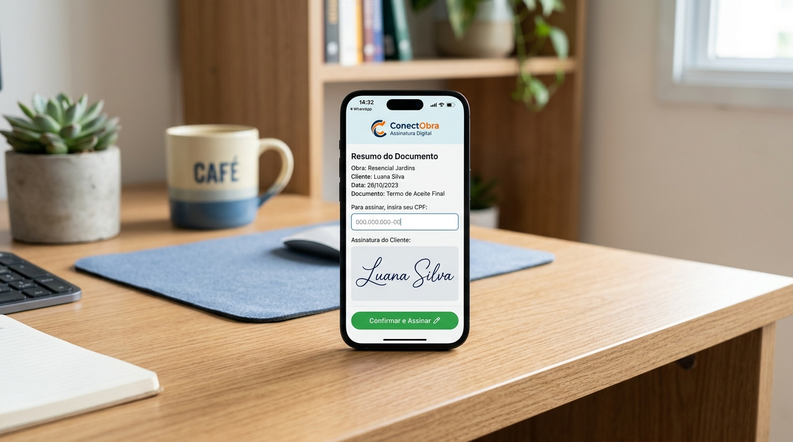

# CONECTOBRA — MANUAL OFICIAL DO USUÁRIO
### Sistema de Gestão de Cadernetas de Obras e Documentação Técnica Digital
**Parceria Institucional • CREA Adamantina**

---

## SUMÁRIO GERAL

1. [INTRODUÇÃO](#1-introdução)
2. [FUNCIONALIDADES DO SISTEMA](#2-funcionalidades-do-sistema)
3. [BENEFÍCIOS ESPERADOS](#3-benefícios-esperados)
4. [COMO ACESSAR O SISTEMA?](#4-como-acessar-o-sistema)
5. [SOLICITAÇÃO DE CADASTRO E HABILITAÇÃO](#5-solicitação-de-cadastro-e-habilitação)
6. [PAINEL DO GESTOR CREA: APROVAÇÃO DE USUÁRIOS](#6-painel-do-gestor-crea-aprovação-de-usuários)
7. [BIBLIOTECA DE CADERNETAS (OBRAS)](#7-biblioteca-de-cadernetas-obras)
8. [ABERTURA DE UMA NOVA CADERNETA](#8-abertura-de-uma-nova-caderneta)
9. [RECIBO DE RESPONSABILIDADE TÉCNICA](#9-recibo-de-responsabilidade-técnica)
10. [HOMOLOGAÇÃO E ASSINATURA DIGITAL DO RECIBO (ENGENHEIRO ⟷ CREA)](#10-homologação-e-assinatura-digital-do-recibo-engenheiro--crea)
11. [DIÁRIO DE OBRA: RELATOS DE VISITAS TÉCNICAS](#11-diário-de-obra-relatos-de-visitas-técnicas)
12. [ASSINATURA DO PROPRIETÁRIO VIA WHATSAPP](#12-assinatura-do-proprietário-via-whatsapp)
13. [TERMO DE CONCLUSÃO DOS SERVIÇOS TÉCNICOS](#13-termo-de-conclusão-dos-serviços-técnicos)
14. [LOGOUT DO SISTEMA](#14-logout-do-sistema)
15. [FAQ — PERGUNTAS FREQUENTES](#15-faq--perguntas-frequentes)
16. [GLOSSÁRIO TÉCNICO E JURÍDICO](#16-glossário-técnico-e-jurídico)

---

## 1. INTRODUÇÃO

O **ConectObra** é uma plataforma tecnológica concebida para modernizar, padronizar e dar segurança jurídica ao registro das atividades técnicas da construção civil. Atuando como o **Livro de Ordem Eletrônico** do município de Adamantina e região, o sistema viabiliza o acompanhamento sistemático de obras desde a contratação inicial até a desoneração de responsabilidade na conclusão dos serviços.

### 1.1. Contexto Normativo
O sistema atende rigorosamente às diretrizes do **CONFEA (Conselho Federal de Engenharia e Agronomia)** e do **CREA-SP**, em especial:
- **Resolução CONFEA nº 1.025/2009**: Regulamenta a Anotação de Responsabilidade Técnica (ART) e o Livro de Ordem de obras e serviços.
- **Resolução CONFEA nº 1.094/2017**: Dispõe sobre a adoção do Livro de Ordem Eletrônico como mecanismo oficial de memória técnica e fiscalização.
- **Medida Provisória nº 2.200-2/2001 e Lei Federal nº 14.063/2020**: Conferem plena validade jurídica aos atos, assinaturas eletrônicas avançadas e trilhas de auditoria geradas pelo sistema.

### 1.2. Objetivo deste Manual
Este manual foi elaborado para orientar os diferentes atores que interagem com o sistema — **Engenheiros Civis, Arquitetos, Gestores do CREA e Proprietários de Obras** —, apresentando o passo a passo operacional de cada ferramenta de forma clara, ilustrada e acessível.

---

## 2. FUNCIONALIDADES DO SISTEMA

O ConectObra reúne um ecossistema completo de ferramentas digitais:

- **Autenticação Flexível**: Login facilitado por e-mail ou número de registro no CREA.
- **Gestão de Solicitações de Acesso**: Triagem rigorosa de novos usuários pela diretoria do CREA.
- **Dossiê Digital da Obra**: Centralização de todos os documentos técnicos em um único repositório imutável.
- **Recibo Oficial com Homologação Institucional**: Documento de abertura com chancela do responsável técnico e do gestor do CREA.
- **Mecanismo de Travamento de Dados**: Impossibilidade de adulteração documental durante e após os processos de assinatura.
- **Diário de Obra Fotográfico**: Relatos detalhados de visitas com registro de condições climáticas, posições de conformidade e fotos de canteiro.
- **Assinatura Eletrônica do Proprietário via WhatsApp**: Envio de links seguros criptografados, sem necessidade de senhas ou certificados digitais complexos pelo contratante.
- **Certidão de Autenticidade e QR Code**: Cada documento finalizado possui carimbo de tempo, hash SHA-256 e QR Code público para verificação instantânea por prefeituras, cartórios e peritos judiciais.

---

## 3. BENEFÍCIOS ESPERADOS

| Para o Engenheiro / Responsável Técnico | Para o Gestor do CREA | Para o Proprietário / Contratante |
| :--- | :--- | :--- |
| **Proteção Jurídica**: Prova irrefutável de vistorias, orientações técnicas dadas e conformidade da obra. | **Fiscalização Eficiente**: Acesso centralizado e instantâneo aos dados da obra sem necessidade de fiscalização presencial de rotina. | **Transparência Total**: Acompanhamento visual da evolução do imóvel com relatórios fotográficos oficiais. |
| **Eliminação do Papel**: Fim das cadernetas físicas suscetíveis a perda, mofo e danos no canteiro. | **Padronização Municipal**: Registro unificado de áreas, tipologias e dados técnicos em formato auditável. | **Praticidade Extrema**: Assinatura em 10 segundos diretamente na tela do smartphone pelo WhatsApp. |
| **Agilidade com Clientes**: Coleta de assinaturas em minutos, sem deslocamento físico para pegar rubricas. | **Homologação Segura**: Validação de responsabilidade com confirmação de senha institucional. | **Histórico de Valor**: Dossiê completo da construção para fins de Habite-se, financiamento e venda. |

---

## 4. COMO ACESSAR O SISTEMA?

O acesso ao ConectObra é realizado via navegador web (computador ou celular).

### 4.1. Passo a Passo de Login:
1. Acesse o endereço oficial do sistema: `http://127.0.0.1:8000/login/` (ou domínio institucional em produção).
2. No campo **E-mail ou Número do CREA**, digite:
   - O seu endereço de e-mail cadastrado (ex: `engenheiro@teste.com`), **OU**
   - O seu número de registro profissional no CREA (ex: `123456/SP`).
3. No campo **Senha**, insira a sua senha cadastrada.
4. Clique no botão verde **"Entrar no Sistema"**.

### 4.2. Perfis e Telas de Destino:
- **Engenheiros (Nível 3)**: São direcionados automaticamente para a [Biblioteca de Cadernetas](#7-biblioteca-de-cadernetas-obras) (`/cadernetas/`).
- **Gestores e Desenvolvedores (Níveis 1 e 2)**: São direcionados para o [Painel Administrativo](#6-painel-do-gestor-crea-aprovação-de-usuários) (`/painel/`).

---

## 5. SOLICITAÇÃO DE CADASTRO E HABILITAÇÃO

Profissionais recém-formados ou ainda não credenciados na plataforma devem submeter uma solicitação formal antes de utilizar o sistema:

1. Na tela de login, clique no link **"Solicitar Cadastro"**.
2. Preencha os dados do formulário obrigatório:
   - **Nome Completo**;
   - **E-mail Institucional/Profissional**;
   - **Telefone Celular / WhatsApp**;
   - **Data de Nascimento**;
   - **Número de Registro no CREA** (com UF correspondente);
   - **Endereço Completo** (CEP, Logradouro, Número, Bairro, Cidade e UF).
3. Clique em **"Enviar Solicitação de Cadastro"**.
4. O sistema gravará a proposta com status `pendente` e a encaminhará para a fila de análise da diretoria do CREA.

---

## 6. PAINEL DO GESTOR CREA: APROVAÇÃO DE USUÁRIOS

O módulo administrativo é de acesso exclusivo aos funcionários autorizados do CREA (Nível 2) e desenvolvedores (Nível 1).

### 6.1. Triagem de Solicitações
Na aba **"Solicitações de Cadastro"**:
- O gestor visualiza os profissionais que aguardam credenciamento.
- Clica no registro para checar o nome, CPF, e-mail e conferir a regularidade do número do CREA na base oficial.

### 6.2. Decisão do Gestor:
- **Aprovação**: Ao clicar em **"Aprovar Cadastro"**, o sistema cria a conta do profissional, define o nível 3 (Engenheiro) e gera uma senha provisória enviada automaticamente por e-mail com as instruções de primeiro acesso.
- **Negação**: Caso os dados estejam irregulares ou o CREA esteja inativo, o gestor clica em **"Negar Cadastro"** e informa a justificativa. O solicitante recebe um e-mail explicando o motivo da recusa.

---

## 7. BIBLIOTECA DE CADERNETAS (OBRAS)

A Biblioteca de Cadernetas é a central de comando do Responsável Técnico.

### 7.1. Navegação e Filtros
- **Aba "Em Andamento"**: Exibe todas as obras cujos documentos ou serviços ainda não foram concluídos.
- **Aba "Concluídas"**: Exibe as obras encerradas formalmente com Termo de Conclusão homologado.
- **Barra de Pesquisa**: Permite filtrar obras instantaneamente pelo nome/apelido ou pelo nome do proprietário.
- **Filtro por Ano**: Permite selecionar o ano de início dos trabalhos para consultas rápidas de arquivos antigos.

### 7.2. Cartão da Caderneta
Cada obra é apresentada em um cartão limpo contendo:
- Ícone ou foto da fachada;
- Apelido da obra;
- Nome do proprietário/contratante;
- Ano de abertura;
- Selo de status (*Em andamento* ou *Concluída*).

---

## 8. ABERTURA DE UMA NOVA CADERNETA

Para dar início a um novo registro de obra:

1. No canto superior da Biblioteca, clique no botão **"+ Nova Caderneta de Obra"**.
2. No formulário de abertura, preencha:
   - **Apelido da Obra**: Nome identificador único (ex: *Residência Silva*, *Galpão Industrial Trevo*, *Reforma Loja Centro*).
   - **Foto / Ícone da Obra** *(opcional)*: Imagem da fachada, maquete 3D ou logotipo da construtora.
3. Clique em **"Criar Caderneta"**.
4. O sistema abrirá automaticamente a tela do **Dossiê da Obra**, estruturada em 3 seções normativas:
   - **1. Recibo de Responsabilidade Técnica** *(obrigatório)*;
   - **2. Relatos de Visita Técnica**;
   - **3. Termo de Conclusão dos Serviços**.

---

## 9. RECIBO DE RESPONSABILIDADE TÉCNICA

O **Recibo** é a certidão de abertura da obra. Nenhum relato de visita pode ser inserido antes do preenchimento e homologação deste documento.

### 9.1. Preenchimento dos Dados:
- **Quadro 1 — Dados do Contratante / Proprietário**:
  - Nome completo ou Razão Social;
  - CPF ou CNPJ;
  - E-mail e Celular / WhatsApp.
- **Quadro 2 — Dados da Obra e Local**:
  - Empresa contratante;
  - Endereço completo do canteiro de obras;
  - Tipo de Edificação (*Residencial*, *Comercial*, *Industrial* ou *Outros*);
  - Atividade Técnica contratada (*Direção Técnica*, *Execução*, *Fiscalização*, *Projeto* ou *Outros*).
- **Quadro 3 — Quadro de Áreas (m²)**:
  - Área a Construir;
  - Área a Ampliar;
  - Área a Reformar;
  - Área a Regularizar;
  - *Área Total calculada automaticamente pelo sistema em tempo real.*
- **Quadro 4 — Prazos e Valores**:
  - Data formal da contratação e Valor estimado da obra.

---

## 10. HOMOLOGAÇÃO E ASSINATURA DIGITAL DO RECIBO (ENGENHEIRO ⟷ CREA)

O Recibo possui um fluxo rigoroso de conformidade institucional entre o Engenheiro e o Gestor do CREA:

### 10.1. Envio e Travamento pelo Engenheiro
1. Quando o engenheiro concluir o preenchimento, clica no botão:
   **`[ Assinar e Solicitar Homologação do CREA ]`**.
2. O sistema grava a assinatura eletrônica do engenheiro com registro de IP e carimbo de tempo.
3. **Travamento Automático**: O formulário do Recibo fica **completamente bloqueado para edição**.
4. O documento é enviado para a fila institucional do CREA (`status: aguardando_gestor`).

### 10.2. Análise pelo Gestor do CREA
O gestor acessa o documento oficial timbrado no `/painel/`:
- **Se Aprovar**:
  1. Clica em **"Homologar e Assinar Recibo"**.
  2. Digita a sua **senha de login institucional** como segundo fator de confirmação.
  3. O Recibo recebe o selo **`Homologado e Concluído`**.
  4. O engenheiro recebe um e-mail de confirmação e a caderneta é liberada para novos relatos.
- **Se Recusar**:
  1. Clica em **"Recusar Assinatura"**.
  2. Digita obrigatoriamente o **Motivo da Inconsistência**.
  3. O engenheiro recebe imediatamente um e-mail de notificação.

### 10.3. Pop-up de Retificação para o Engenheiro
Se o Recibo for recusado:
- Ao abrir a obra, surge um **Pop-up de Alerta** com o texto da recusa apontado pelo gestor.
- O engenheiro clica em *"Entendido, Corrigir Informações"*.
- O formulário é **destravado para edição** (`em_andamento`), permitindo corrigir os dados e solicitar nova análise.

---

## 11. DIÁRIO DE OBRA: RELATOS DE VISITAS TÉCNICAS

O Diário de Obra registra a evolução física e a fiscalização presencial das etapas construtivas:

1. Na seção 2 do Dossiê, clique em **"+ Adicionar Novo Relato de Visita Técnica"**.
2. Preencha os campos de vistoria:
   - **Data da Visita**: Dia da vistoria no canteiro;
   - **Serviços Executados**: Seleção com caixas de marcação (*Fundação, Alvenaria, Cobertura, Estrutura, Hidráulica, Elétrica, Acabamento, Outros*);
   - **Posição da Obra**:
     - *De acordo com o projeto*;
     - *Em desacordo com o projeto* (exige apontamento de soluções);
     - *Em andamento*;
     - *Paralisada*;
   - **Decisões Técnicas e Observações**: Orientações repassadas ao mestre de obras e empreiteiros;
   - **Fotos da Visita**: Anexação de múltiplas fotos comprobatórias do canteiro.
3. Clique em **"Salvar Relato"**.

---

## 12. ASSINATURA DO PROPRIETÁRIO VIA WHATSAPP

Ao contrário do Recibo, os **Relatos de Visita** e o **Termo de Conclusão** devem ser assinados pelo **Proprietário da Obra** para atestar ciência das vistorias e entrega dos serviços.

### 12.1. Como o Engenheiro Dispara o Envio:
1. No relato ou termo com status `pronto_assinar`, o engenheiro clica no botão verde:
   **`[ Enviar para o Proprietário via WhatsApp ]`**.
2. O sistema abre o WhatsApp do profissional com mensagem pré-formatada contendo o link criptográfico único (ex: `conectobra.com.br/assinar/d8f2a1b9-3c4e-4e89-a212-32a87c0e9b41/`).
3. O engenheiro envia a mensagem para o proprietário com um clique.

### 12.2. Como o Proprietário Assina no Smartphone:
1. O proprietário toca no link recebido no WhatsApp.
2. Abre uma tela mobile limpa e segura com o resumo do documento e as fotos da obra.
3. Clica em **"Assinar Documento"**.
4. **Validação**: Digita o seu **CPF** (o sistema confere se bate com o cadastro).
5. O sistema exibe o nome do proprietário renderizado em **tipografia cursiva clássica/caligráfica** (sem necessidade de desenhar com o dedo).
6. Marca o termo de aceite legal e clica em **"Confirmar e Assinar"**.
7. O documento é concluído instantaneamente, com gravação de IP, data/hora e hash SHA-256 nos bastidores.

---

## 13. TERMO DE CONCLUSÃO DOS SERVIÇOS TÉCNICOS

O **Termo de Conclusão** é a peça documental que encerra a responsabilidade técnica do engenheiro sobre a obra:

1. Quando todas as etapas contratuais forem finalizadas, clique em **"+ Lavrar Termo de Conclusão Oficial"**.
2. Preencha a declaração de entrega física da obra.
3. O engenheiro assina digitalmente o termo.
4. O link de assinatura é enviado ao proprietário via WhatsApp para assinatura final de quitação técnica.
5. Após a assinatura de ambas as partes:
   - A Caderneta recebe a chancela de **Obra Concluída**.
   - É transferida para a aba de arquivos históricos (*Concluídas*).
   - O PDF completo timbrado com todas as certidões e QR Code fica disponível para download.

---

## 14. LOGOUT DO SISTEMA

Para garantir a confidencialidade e a segurança das suas credenciais:

1. No menu superior direito, clique sobre o seu nome de usuário.
2. Selecione a opção **"Sair" / "Logout"**.
3. A sua sessão criptografada será encerrada de imediato e você será reconduzido à tela inicial.

> [!TIP]
> Em computadores de uso compartilhado ou em escritórios coletivos, nunca deixe o sistema logado em abas abertas.

---

## 15. FAQ — PERGUNTAS FREQUENTES

### 1. O proprietário precisa ter certificado digital (tipo Token A1/A3) para assinar?
**Não.** O proprietário assina através da modalidade de **Assinatura Eletrônica Avançada** (Lei nº 14.063/2020), autenticada pela posse do canal de WhatsApp, conferência de CPF e trilha de auditoria digital (IP, carimbo de data/hora e hash criptográfico).

### 2. Por que o Recibo da obra ficou bloqueado e não consigo editar os dados?
Assim que o engenheiro clica em *"Assinar e Solicitar Homologação do CREA"*, o Recibo é congelado para evitar adulterações enquanto o gestor analisa. Caso o gestor aponte alguma pendência, o sistema reabrirá os campos para edição automaticamente.

### 3. O que acontece se o Gestor do CREA recusar o meu Recibo?
Você receberá um e-mail imediato com o motivo da inconsistência e, ao acessar a obra, um pop-up de alerta explicará detalhadamente a razão. Ao confirmar o pop-up, o formulário volta a ficar editável para que você corrija os dados e reenvie para nova assinatura.

### 4. Os documentos gerados têm validade para pedidos de Habite-se na Prefeitura?
**Sim.** Todos os documentos do ConectObra contam com identificação de responsabilidade técnica, número de ART/CREA, hash SHA-256 e QR Code público de autenticidade, possuindo validade probatória em conformidade com o Art. 10 da MP 2.200-2/2001.

### 5. Posso excluir uma foto anexada a um relato de visita?
Enquanto o relato estiver em andamento, você pode clicar no ícone de lixeira sobre a foto indesejada para removê-la. Uma vez que o relato for assinado pelo proprietário, as fotos tornam-se parte do dossiê imutável e não podem mais ser apagadas.

---

## 16. GLOSSÁRIO TÉCNICO E JURÍDICO

- **ART (Anotação de Responsabilidade Técnica)**: Instrumento legal instituído pela Lei nº 6.496/1977 que define os responsáveis técnicos pelo desenvolvimento de atividades da engenharia.
- **Assinatura Eletrônica Avançada**: Modalidade de assinatura prevista na Lei nº 14.063/2020 associada de forma unívoca ao signatário e dotada de integridade irrefutável.
- **Caderneta de Obra / Livro de Ordem**: Registro oficial e obrigatório da evolução das obras e intervenções técnicas fiscalizadas por engenheiros e arquitetos.
- **Carimbo de Tempo (Timestamp)**: Informação temporal sincronizada via servidor NTP que atesta a data e o segundo exatos em que determinado ato ocorreu.
- **CREA**: Conselho Regional de Engenharia e Agronomia, autarquia responsável pela fiscalização do exercício profissional.
- **Dossiê da Obra**: Conjunto ordenado e integrado de todos os documentos (Recibo, Relatos de Visita e Termo de Conclusão) vinculados a uma caderneta.
- **Hash SHA-256**: Algoritmo matemático criptográfico que gera um código alfanumérico único para um arquivo. Qualquer alteração de um único caractere no documento gera um hash completamente diferente, provando se houve ou não fraude.
- **Homologação Institucional**: Ato administrativo pelo qual o gestor do CREA chancela a regularidade do Recibo de responsabilidade técnica.
- **QR Code de Validação**: Código bidimensional impresso no documento que conduz o leitor diretamente para a certidão pública de autenticidade do ConectObra.
- **Responsável Técnico (RT)**: Profissional habilitado pelo conselho de classe legalmente responsável pelos projetos e obras executadas.
- **Trilha de Auditoria (Audit Trail)**: Registro cronológico de evidências digitais (endereço IP, porta lógica, User-Agent, e-mail, telefone e data/hora) coletadas no momento da assinatura.
- **UUID (Universally Unique Identifier)**: Identificador criptográfico de 128 bits utilizado nos links seguros de assinatura, impossível de ser adivinhado ou fraudado.
